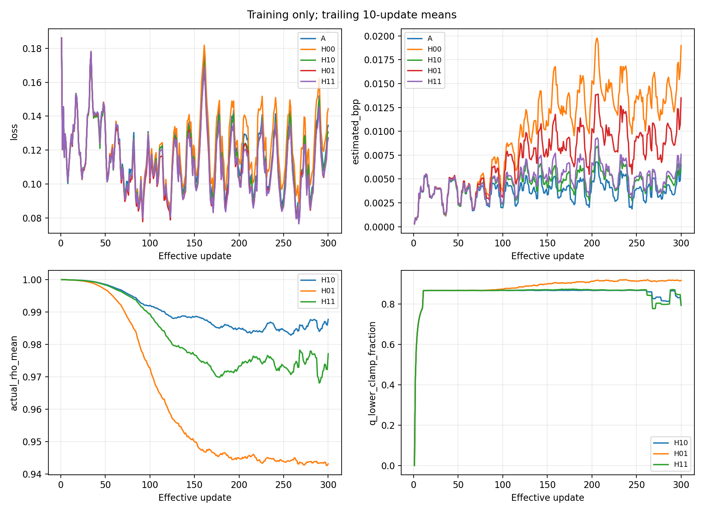
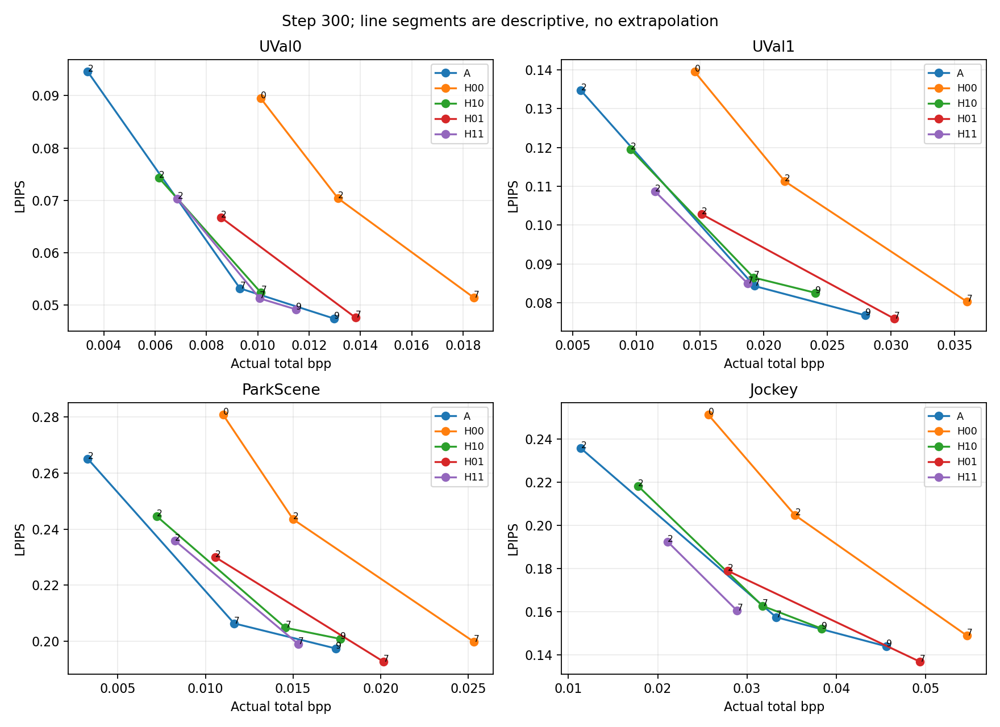
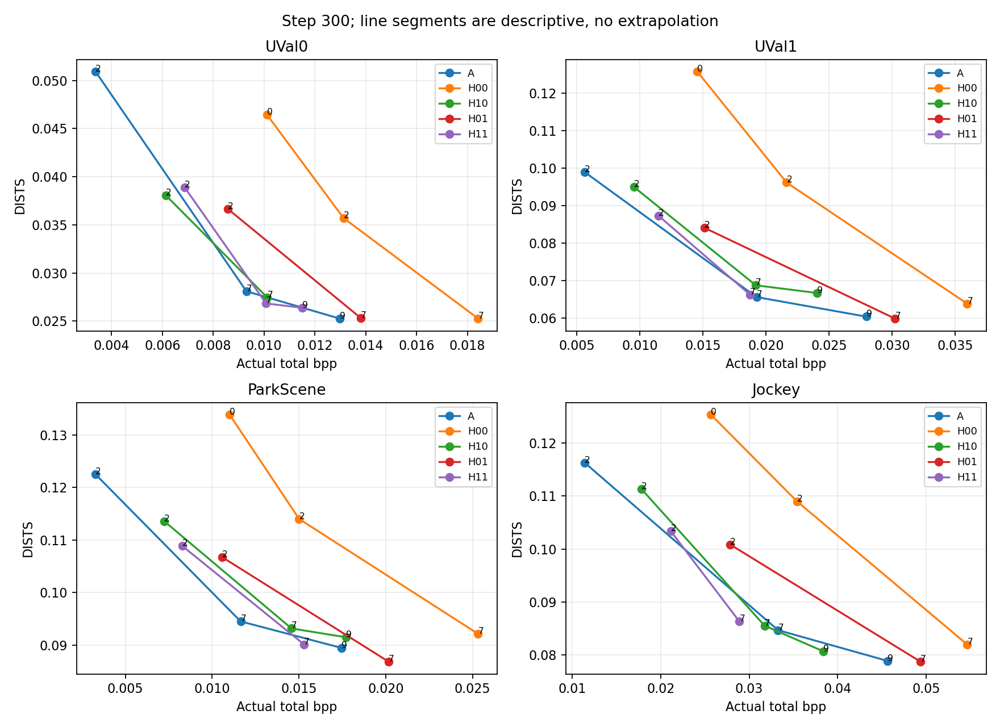
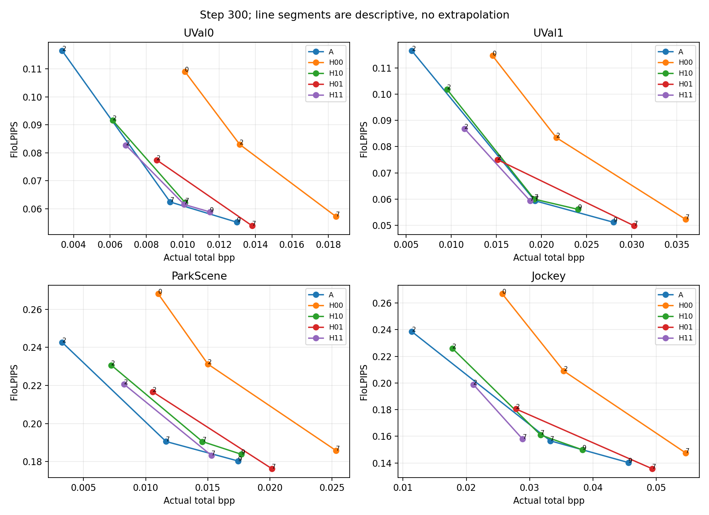
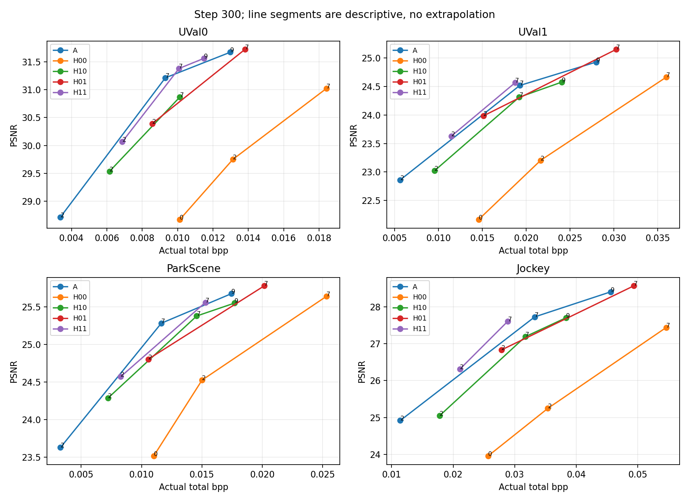
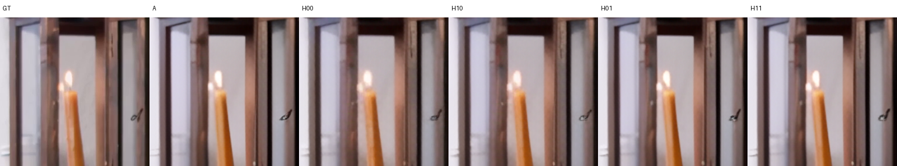
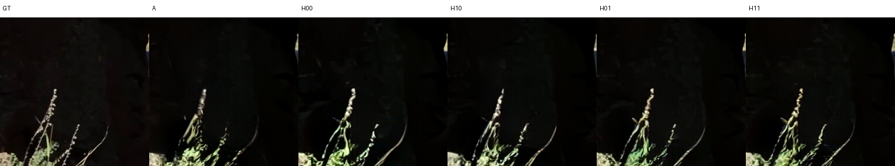
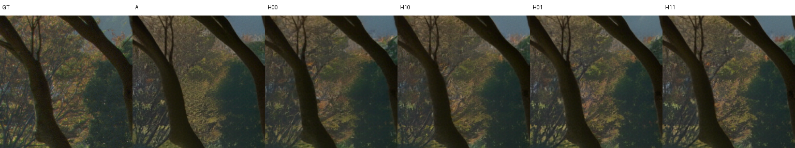
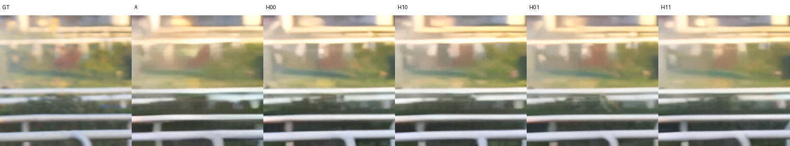

# Measured v2 skip/domain trend results

H10, H01 and H11 completed exactly 300 effective optimizer updates each from the common G_basic_100 and v1 B initial H. A/H00 reuse v1 A/B training; neither was retrained. No V or new probability parameters were added.

Preflight: PASS. All 92 evaluation tasks independently decoded persisted streams and checked all 64 causal references; 22 are explicitly reused v1 measurements and 70 are new measurements. New tasks additionally check every P latent/qmap exactly. The declared tolerances and actual maximum errors are in preflight.json. Frozen-parameter hashes are unchanged in all three new groups.

## Step 300 fixed-QP measurements

These are measured at the same external QP, which does not imply the same actual bitrate. Differences and rate/quality conclusions below use actual-bpp overlap.

| Video | Group | QP | Actual bpp | LPIPS | DISTS | FloLPIPS | PSNR dB |
|---|---|---:|---:|---:|---:|---:|---:|
| UVal0 | A | 2 | 0.003373 | 0.09456 | 0.05091 | 0.11647 | 28.714 |
| UVal0 | A | 7 | 0.009306 | 0.05322 | 0.02810 | 0.06238 | 31.213 |
| UVal0 | H00 | 2 | 0.013127 | 0.07040 | 0.03571 | 0.08300 | 29.750 |
| UVal0 | H00 | 7 | 0.018422 | 0.05144 | 0.02526 | 0.05717 | 31.023 |
| UVal0 | H10 | 2 | 0.006143 | 0.07434 | 0.03805 | 0.09162 | 29.533 |
| UVal0 | H10 | 7 | 0.010127 | 0.05238 | 0.02745 | 0.06217 | 30.869 |
| UVal0 | H01 | 2 | 0.008571 | 0.06673 | 0.03666 | 0.07739 | 30.393 |
| UVal0 | H01 | 7 | 0.013807 | 0.04765 | 0.02532 | 0.05389 | 31.723 |
| UVal0 | H11 | 2 | 0.006871 | 0.07034 | 0.03891 | 0.08272 | 30.066 |
| UVal0 | H11 | 7 | 0.010078 | 0.05130 | 0.02683 | 0.06149 | 31.381 |
| UVal1 | A | 2 | 0.005635 | 0.13470 | 0.09886 | 0.11652 | 22.862 |
| UVal1 | A | 7 | 0.019262 | 0.08430 | 0.06553 | 0.05938 | 24.518 |
| UVal1 | H00 | 2 | 0.021647 | 0.11130 | 0.09608 | 0.08342 | 23.205 |
| UVal1 | H00 | 7 | 0.035971 | 0.08024 | 0.06377 | 0.05228 | 24.664 |
| UVal1 | H10 | 2 | 0.009541 | 0.11950 | 0.09489 | 0.10177 | 23.022 |
| UVal1 | H10 | 7 | 0.019201 | 0.08648 | 0.06867 | 0.05999 | 24.313 |
| UVal1 | H01 | 2 | 0.015127 | 0.10280 | 0.08401 | 0.07503 | 23.986 |
| UVal1 | H01 | 7 | 0.030251 | 0.07588 | 0.05978 | 0.04986 | 25.150 |
| UVal1 | H11 | 2 | 0.011473 | 0.10861 | 0.08726 | 0.08682 | 23.631 |
| UVal1 | H11 | 7 | 0.018740 | 0.08493 | 0.06616 | 0.05933 | 24.568 |
| ParkScene | A | 2 | 0.003284 | 0.26514 | 0.12250 | 0.24262 | 23.630 |
| ParkScene | A | 7 | 0.011640 | 0.20638 | 0.09451 | 0.19058 | 25.281 |
| ParkScene | H00 | 2 | 0.015010 | 0.24351 | 0.11402 | 0.23123 | 24.525 |
| ParkScene | H00 | 7 | 0.025322 | 0.19982 | 0.09214 | 0.18584 | 25.638 |
| ParkScene | H10 | 2 | 0.007238 | 0.24454 | 0.11360 | 0.23064 | 24.289 |
| ParkScene | H10 | 7 | 0.014571 | 0.20482 | 0.09317 | 0.19054 | 25.377 |
| ParkScene | H01 | 2 | 0.010559 | 0.23004 | 0.10678 | 0.21670 | 24.803 |
| ParkScene | H01 | 7 | 0.020169 | 0.19271 | 0.08684 | 0.17628 | 25.777 |
| ParkScene | H11 | 2 | 0.008274 | 0.23581 | 0.10889 | 0.22059 | 24.570 |
| ParkScene | H11 | 7 | 0.015291 | 0.19907 | 0.09013 | 0.18329 | 25.557 |
| Jockey | A | 2 | 0.011396 | 0.23566 | 0.11629 | 0.23848 | 24.920 |
| Jockey | A | 7 | 0.033264 | 0.15757 | 0.08468 | 0.15661 | 27.726 |
| Jockey | H00 | 2 | 0.035396 | 0.20471 | 0.10901 | 0.20899 | 25.249 |
| Jockey | H00 | 7 | 0.054660 | 0.14900 | 0.08197 | 0.14754 | 27.440 |
| Jockey | H10 | 2 | 0.017800 | 0.21824 | 0.11134 | 0.22590 | 25.051 |
| Jockey | H10 | 7 | 0.031744 | 0.16278 | 0.08552 | 0.16094 | 27.191 |
| Jockey | H01 | 2 | 0.027831 | 0.17905 | 0.10087 | 0.18051 | 26.829 |
| Jockey | H01 | 7 | 0.049377 | 0.13697 | 0.07872 | 0.13566 | 28.566 |
| Jockey | H11 | 2 | 0.021126 | 0.19241 | 0.10338 | 0.19877 | 26.317 |
| Jockey | H11 | 7 | 0.028897 | 0.16057 | 0.08630 | 0.15789 | 27.609 |

## Matched actual-rate differences

The following descriptive piecewise-linear comparisons evaluate the midpoint of the measured overlap in each video. Delta is method minus reference: negative LPIPS/DISTS/FloLPIPS and positive PSNR favor the method. Full endpoints and intervals appear in matched_rate_comparisons.csv. No extrapolation or formal BD-rate is used. Supplemental QP choices and the rate-only evidence are in supplement_selection.json.

| Video | Method − reference | Overlap bpp | Midpoint bpp | ΔLPIPS | ΔDISTS | ΔFloLPIPS | ΔPSNR dB |
|---|---|---|---:|---:|---:|---:|---:|
| UVal0 | H00 − A | 0.010121–0.012982 | 0.011551 | +0.03069 | +0.01496 | +0.03868 | -2.311 |
| UVal0 | H10 − A | 0.006143–0.010127 | 0.008135 | +0.00198 | +0.00015 | +0.00384 | -0.519 |
| UVal0 | H01 − A | 0.008571–0.012982 | 0.010776 | +0.00778 | +0.00492 | +0.00801 | -0.444 |
| UVal0 | H11 − A | 0.006871–0.011501 | 0.009186 | +0.00254 | +0.00164 | +0.00392 | -0.148 |
| UVal0 | H10 − H00 | 0.010121–0.010127 | 0.010124 | -0.03703 | -0.01895 | -0.04679 | +2.198 |
| UVal0 | H01 − H00 | 0.010121–0.013807 | 0.011964 | -0.02341 | -0.01054 | -0.03090 | +1.923 |
| UVal0 | H11 − H00 | 0.010121–0.011501 | 0.010811 | -0.03486 | -0.01736 | -0.04293 | +2.558 |
| UVal0 | H01 − H10 | 0.008571–0.010127 | 0.009349 | +0.00722 | +0.00546 | +0.00598 | -0.017 |
| UVal0 | H11 − H10 | 0.006871–0.010127 | 0.008499 | -0.00068 | +0.00100 | -0.00226 | +0.410 |
| UVal0 | H11 − H01 | 0.008571–0.011501 | 0.010036 | -0.00984 | -0.00649 | -0.00904 | +0.598 |
| UVal1 | H00 − A | 0.014568–0.027970 | 0.021269 | +0.03024 | +0.03333 | +0.02760 | -1.463 |
| UVal1 | H10 − A | 0.009541–0.024063 | 0.016802 | +0.00127 | +0.00364 | +0.00067 | -0.227 |
| UVal1 | H01 − A | 0.015127–0.027970 | 0.021549 | +0.00905 | +0.00956 | +0.00712 | -0.145 |
| UVal1 | H11 − A | 0.011473–0.018740 | 0.015107 | -0.00290 | +0.00102 | -0.00372 | +0.087 |
| UVal1 | H10 − H00 | 0.014568–0.024063 | 0.019316 | -0.03421 | -0.03720 | -0.03381 | +1.457 |
| UVal1 | H01 − H00 | 0.015127–0.030251 | 0.022689 | -0.01970 | -0.02184 | -0.01871 | +1.257 |
| UVal1 | H11 − H00 | 0.014568–0.018740 | 0.016654 | -0.03947 | -0.04473 | -0.03823 | +1.827 |
| UVal1 | H01 − H10 | 0.015127–0.024063 | 0.019595 | +0.00869 | +0.00834 | +0.00792 | -0.004 |
| UVal1 | H11 − H10 | 0.011473–0.018740 | 0.015107 | -0.00370 | -0.00307 | -0.00462 | +0.334 |
| UVal1 | H11 − H01 | 0.015127–0.018740 | 0.016934 | -0.00876 | -0.00971 | -0.00586 | +0.210 |
| ParkScene | H00 − A | 0.011010–0.017452 | 0.014231 | +0.04840 | +0.02563 | +0.05240 | -1.128 |
| ParkScene | H10 − A | 0.007238–0.017452 | 0.012345 | +0.01158 | +0.00547 | +0.01337 | -0.282 |
| ParkScene | H01 − A | 0.010559–0.017452 | 0.014006 | +0.01392 | +0.00717 | +0.01579 | -0.288 |
| ParkScene | H11 − A | 0.008274–0.015291 | 0.011783 | +0.01128 | +0.00512 | +0.01161 | -0.227 |
| ParkScene | H10 − H00 | 0.011010–0.017710 | 0.014360 | -0.04362 | -0.02349 | -0.04553 | +0.985 |
| ParkScene | H01 − H00 | 0.011010–0.020169 | 0.015590 | -0.03056 | -0.01645 | -0.03313 | +0.726 |
| ParkScene | H11 − H00 | 0.011010–0.015291 | 0.013151 | -0.05059 | -0.02740 | -0.05371 | +1.200 |
| ParkScene | H01 − H10 | 0.010559–0.017710 | 0.014134 | +0.00896 | +0.00497 | +0.00873 | -0.146 |
| ParkScene | H11 − H10 | 0.008274–0.015291 | 0.011783 | -0.00248 | -0.00143 | -0.00385 | +0.101 |
| ParkScene | H11 − H01 | 0.010559–0.015291 | 0.012925 | -0.00939 | -0.00542 | -0.01088 | +0.181 |
| Jockey | H00 − A | 0.025676–0.045625 | 0.035651 | +0.04901 | +0.02510 | +0.05472 | -2.579 |
| Jockey | H10 − A | 0.017800–0.038373 | 0.028086 | +0.00127 | +0.00013 | +0.00199 | -0.432 |
| Jockey | H01 − A | 0.027831–0.045625 | 0.036728 | +0.00789 | +0.00867 | +0.00996 | -0.369 |
| Jockey | H11 − A | 0.021126–0.028897 | 0.025011 | -0.01055 | -0.00177 | -0.00917 | +0.296 |
| Jockey | H10 − H00 | 0.025676–0.038373 | 0.032024 | -0.05850 | -0.02937 | -0.06859 | +2.411 |
| Jockey | H01 − H00 | 0.027831–0.049377 | 0.038604 | -0.03742 | -0.01471 | -0.04067 | +2.084 |
| Jockey | H11 − H00 | 0.025676–0.028897 | 0.027286 | -0.07633 | -0.03282 | -0.09090 | +3.168 |
| Jockey | H01 − H10 | 0.027831–0.038373 | 0.033102 | +0.00813 | +0.01092 | +0.01087 | -0.041 |
| Jockey | H11 − H10 | 0.021126–0.028897 | 0.025011 | -0.01307 | -0.00315 | -0.01397 | +0.805 |
| Jockey | H11 − H01 | 0.027831–0.028897 | 0.028364 | -0.01526 | -0.01285 | -0.01870 | +0.648 |

## Declared comparisons and interaction

- Skipped-symbol gradient treatment, H10−H00: lower interpolated LPIPS in 4/4 overlapping videos; see the per-video deltas above. These observations do not identify a causal mechanism beyond the controlled intervention.
- Coordinate reparameterization, H01−H00: lower interpolated LPIPS in 4/4 overlapping videos; see the per-video deltas above. These observations do not identify a causal mechanism beyond the controlled intervention.
- Adding coordinates to the skip treatment, H11−H10: lower interpolated LPIPS in 4/4 overlapping videos; see the per-video deltas above. These observations do not identify a causal mechanism beyond the controlled intervention.
- Adding skip treatment to coordinates, H11−H01: lower interpolated LPIPS in 4/4 overlapping videos; see the per-video deltas above. These observations do not identify a causal mechanism beyond the controlled intervention.
- H00 versus A: lower interpolated LPIPS in 0/4 overlapping videos. DISTS, FloLPIPS and PSNR are reported separately rather than treating one metric as universal quality.
- H10 versus A: lower interpolated LPIPS in 0/4 overlapping videos. DISTS, FloLPIPS and PSNR are reported separately rather than treating one metric as universal quality.
- H01 versus A: lower interpolated LPIPS in 0/4 overlapping videos. DISTS, FloLPIPS and PSNR are reported separately rather than treating one metric as universal quality.
- H11 versus A: lower interpolated LPIPS in 2/4 overlapping videos. DISTS, FloLPIPS and PSNR are reported separately rather than treating one metric as universal quality.

The descriptive interaction contrast uses H11−H10−H01+H00 at the midpoint of the common four-H overlap. A nonzero value is only an observed contrast in this small run; it is not a statistical interaction test.

| Video | Common actual bpp | LPIPS contrast | DISTS contrast | FloLPIPS contrast | PSNR contrast |
|---|---:|---:|---:|---:|---:|
| UVal0 | 0.010124 | +0.02719 | +0.01248 | +0.03778 | -1.599 |
| UVal1 | 0.016934 | +0.02710 | +0.03124 | +0.02856 | -1.287 |
| ParkScene | 0.013151 | +0.03867 | +0.02057 | +0.03894 | -0.920 |
| Jockey | 0.028364 | +0.04686 | +0.01621 | +0.05546 | -1.708 |

The smallest common four-H interval is UVal0: 0.010120985–0.010127315 bpp (width 0.000006330). Its interaction comparison describes only this very narrow region.

## Audits, plots and limits

- CPU skip check: original dy_hat/dq=−1.5, corrected=.5, local finite difference≈.5 for the fixed skipped state. Active-branch STE and mean/dequantization Jacobians were checked separately.
- H10 and v1 H00 retain the same hard forward under identical nonidentity weights. Actual-rho, q clamp, skip/non-skip, both passes and signed saturation endpoints are covered in synthetic checks.
- A dense-saturation synthetic stream triggered a native C++ RANS segmentation fault during preflight development. Final boundary coverage uses sparse saturation in both passes; the native coder and symbol range were not modified. Formal training was gated until the final complete preflight passed. Dense pathological-stream robustness is not established.
- Training logs include multiplier/rho moments and quantiles, clamp/skip/saturation fractions, G/H gradient norms and update norms, and explicitly estimated y/z bits. Baseline fields unavailable in v1 are left empty rather than reconstructed.
- estimated_vs_actual_P_rate.csv compares analytical estimated y/z bits with actual P1–63 payload only. Exact total/header bytes are separate. No exact actual y/z split is claimed for interleaved RANS.
- per_frame/frames.csv and transitions.csv retain all frames and transitions. frame_segment_summaries.csv separates frames0–14 and15–63; transition assignment uses its destination frame. Fixed images use frame15 and the predeclared region for every method/video at QP2.
- The inherited four-entry QP offset description is retained in effective_config.json. effective_runtime_audit.json records the full unchanged v1 eight-frame schedule used by execution.
- This is a 300-update trend experiment. Sparse interpolation is descriptive and may conceal curve shape. No convergence, significance or strict unseen-data generalization is claimed; historical checkpoint exposure is not fully established. No untested mechanism is asserted and no next-round training is launched.

