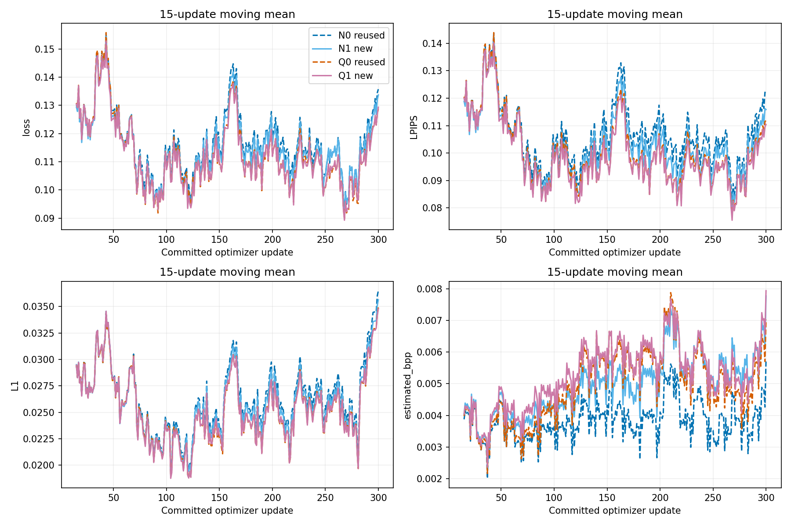
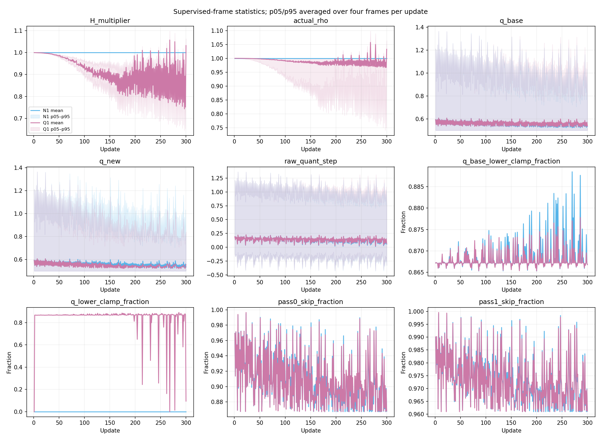
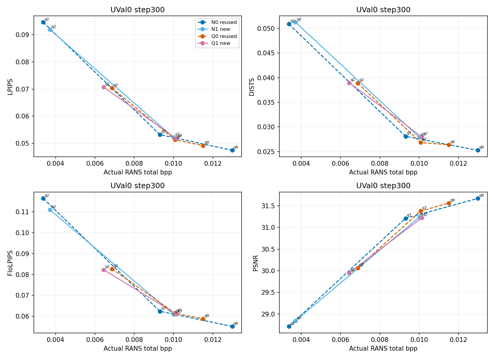
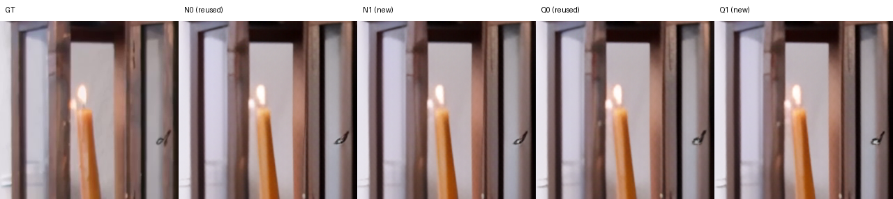
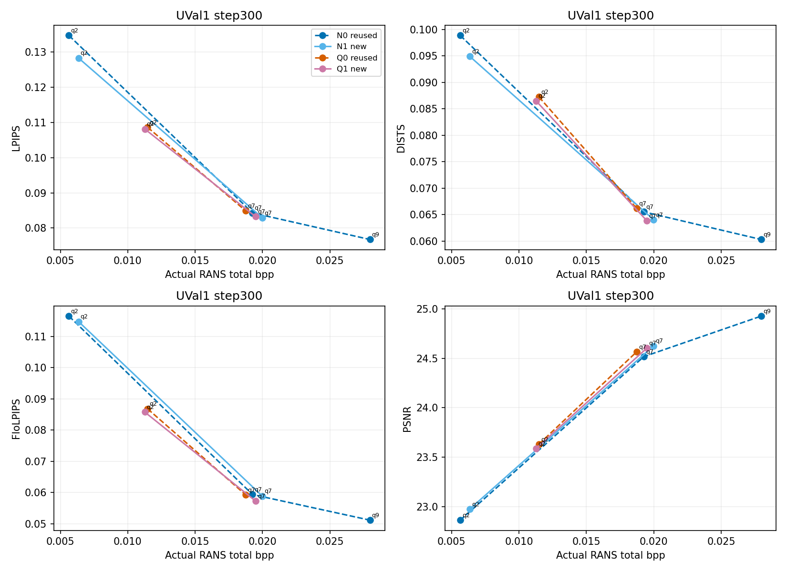
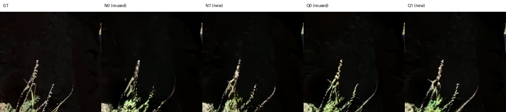
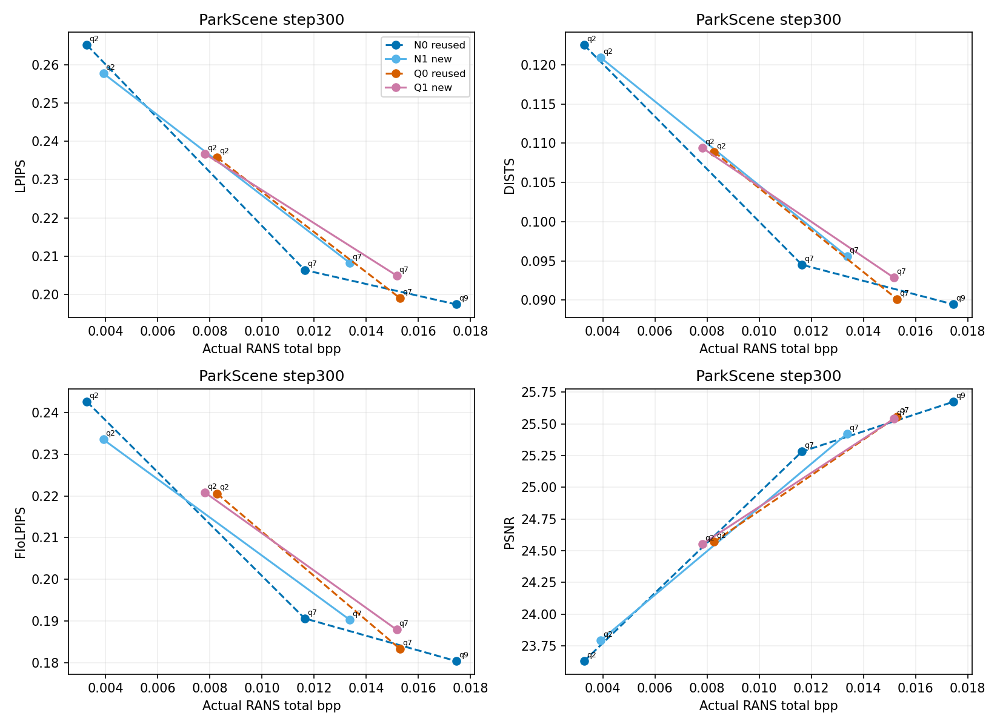
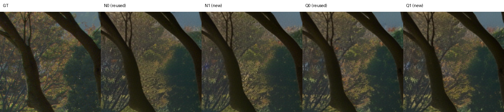
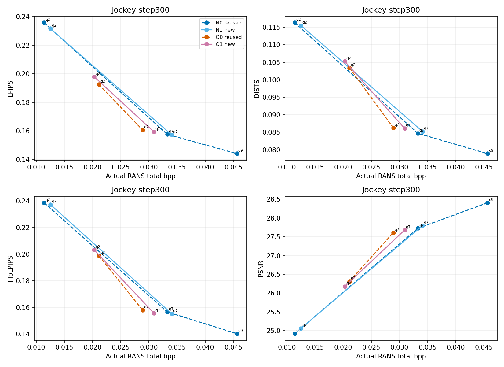
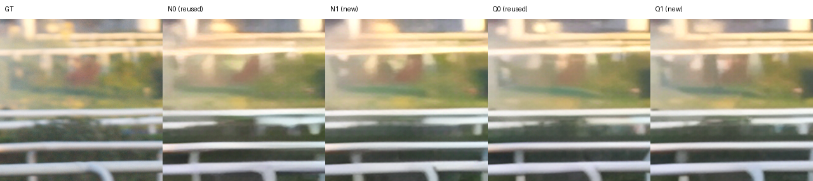

# Quantization and probability adaptation: v3 300-update trend experiment

Four logical conditions, one seed (20261023), 300 updates per condition. N0 reuses v1 A training and v2-verified evaluations; Q0 reuses v2 H11. N1 and Q1 are newly trained from the common original G/Bridge start, with original Phi and identity H for Q1. No spatial visual condition V is installed.

## Actual observed points and dominance

All values below are actual persistent 64-frame RANS encodings with independent decoding. Arrows: LPIPS/DISTS/FloLPIPS lower is better; PSNR higher is better. QP is not a matched-rate comparison. Full step0/100/300 records, time, memory, bytes and provenance are in [evaluation.csv](evaluation.csv).

| branch | sequence | external_qp | actual_bpp | kbps_20fps | LPIPS | DISTS | FloLPIPS | PSNR | evaluation_origin |
| --- | --- | --- | --- | --- | --- | --- | --- | --- | --- |
| N0 | UVal0 | 2 | 0.003372878 | 139.88 | 0.09456132 | 0.05091124 | 0.1164677 | 28.71422 | reused |
| N0 | UVal0 | 7 | 0.009306038 | 385.94 | 0.05322004 | 0.0280963 | 0.06238379 | 31.2132 | reused |
| N0 | UVal0 | 9 | 0.01298189 | 538.385 | 0.04744385 | 0.02525317 | 0.05512976 | 31.67279 | reused |
| N1 | UVal0 | 2 | 0.003712083 | 153.9475 | 0.09185471 | 0.05126025 | 0.1110118 | 28.84707 | new |
| N1 | UVal0 | 7 | 0.01000651 | 414.99 | 0.05217089 | 0.02788204 | 0.06089473 | 31.24009 | new |
| Q0 | UVal0 | 2 | 0.006870961 | 284.9525 | 0.07033777 | 0.03891406 | 0.08271807 | 30.06566 | reused |
| Q0 | UVal0 | 7 | 0.01007825 | 417.965 | 0.05129926 | 0.0268343 | 0.06149042 | 31.38075 | reused |
| Q0 | UVal0 | 9 | 0.01150119 | 476.9775 | 0.04919339 | 0.0263807 | 0.05880196 | 31.56393 | reused |
| Q1 | UVal0 | 2 | 0.006442178 | 267.17 | 0.0707127 | 0.03897267 | 0.08229789 | 29.95363 | new |
| Q1 | UVal0 | 7 | 0.01014154 | 420.59 | 0.05174816 | 0.02797668 | 0.06105659 | 31.22792 | new |
| N0 | UVal1 | 2 | 0.005635067 | 233.6975 | 0.1347036 | 0.09886484 | 0.1165151 | 22.86178 | reused |
| N0 | UVal1 | 7 | 0.01926185 | 798.8275 | 0.08430324 | 0.06553047 | 0.05937767 | 24.51806 | reused |
| N0 | UVal1 | 9 | 0.02797026 | 1159.983 | 0.07675095 | 0.06031231 | 0.05118345 | 24.92838 | reused |
| N1 | UVal1 | 2 | 0.006346029 | 263.1825 | 0.1283076 | 0.09490907 | 0.1147763 | 22.9743 | new |
| N1 | UVal1 | 7 | 0.01998499 | 828.8175 | 0.08291646 | 0.06405037 | 0.05889042 | 24.62728 | new |
| Q0 | UVal1 | 2 | 0.0114734 | 475.825 | 0.1086144 | 0.08726076 | 0.08682239 | 23.6311 | reused |
| Q0 | UVal1 | 7 | 0.01874017 | 777.1925 | 0.08493256 | 0.06616244 | 0.05932954 | 24.56801 | reused |
| Q1 | UVal1 | 2 | 0.01126399 | 467.14 | 0.1081356 | 0.08649969 | 0.08579326 | 23.58792 | new |
| Q1 | UVal1 | 7 | 0.01947772 | 807.78 | 0.08327369 | 0.06387793 | 0.05732944 | 24.60337 | new |
| N0 | ParkScene | 2 | 0.003284264 | 136.205 | 0.2651364 | 0.1225031 | 0.2426161 | 23.62951 | reused |
| N0 | ParkScene | 7 | 0.01164014 | 482.74 | 0.2063802 | 0.09451137 | 0.1905833 | 25.28072 | reused |
| N0 | ParkScene | 9 | 0.01745226 | 723.78 | 0.1974079 | 0.08946101 | 0.180338 | 25.67388 | reused |
| N1 | ParkScene | 2 | 0.003915835 | 162.3975 | 0.2577528 | 0.1209154 | 0.2335454 | 23.79215 | new |
| N1 | ParkScene | 7 | 0.01336944 | 554.4575 | 0.2082466 | 0.09558933 | 0.1902488 | 25.421 | new |
| Q0 | ParkScene | 2 | 0.008274498 | 343.16 | 0.2358117 | 0.1088856 | 0.2205879 | 24.57047 | reused |
| Q0 | ParkScene | 7 | 0.01529128 | 634.16 | 0.1990719 | 0.09012952 | 0.1832948 | 25.55685 | reused |
| Q1 | ParkScene | 2 | 0.007820578 | 324.335 | 0.2366884 | 0.1094008 | 0.2208006 | 24.55262 | new |
| Q1 | ParkScene | 7 | 0.01516903 | 629.09 | 0.204932 | 0.09286293 | 0.187869 | 25.53884 | new |
| N0 | Jockey | 2 | 0.01139648 | 472.635 | 0.2356627 | 0.1162912 | 0.2384825 | 24.91961 | reused |
| N0 | Jockey | 7 | 0.03326359 | 1379.507 | 0.1575666 | 0.08467778 | 0.1566105 | 27.72583 | reused |
| N0 | Jockey | 9 | 0.045625 | 1892.16 | 0.1440625 | 0.07888296 | 0.14028 | 28.40392 | reused |
| N1 | Jockey | 2 | 0.01251182 | 518.89 | 0.2316283 | 0.115493 | 0.2372012 | 25.06283 | new |
| N1 | Jockey | 7 | 0.03407221 | 1413.043 | 0.1571207 | 0.08525266 | 0.1552389 | 27.79677 | new |
| Q0 | Jockey | 2 | 0.02112564 | 876.1225 | 0.1924133 | 0.1033767 | 0.1987731 | 26.31662 | reused |
| Q0 | Jockey | 7 | 0.02889673 | 1198.405 | 0.1605707 | 0.08629675 | 0.157895 | 27.60886 | reused |
| Q1 | Jockey | 2 | 0.02027603 | 840.8875 | 0.1979201 | 0.1052983 | 0.2031897 | 26.17719 | new |
| Q1 | Jockey | 7 | 0.03090459 | 1281.675 | 0.1592808 | 0.08611195 | 0.1556326 | 27.67808 | new |

Observed dominance compares only measured points: method rate ≤ reference rate, quality no worse, and at least one strict inequality. Counts are cross-QP pairs, not independent samples or statistical confidence. [All pairwise measured comparisons](observed_dominance.csv) include unfavorable differences.

| comparison | sequence | measured_pairs | LPIPS | DISTS | FloLPIPS | PSNR | joint |
| --- | --- | --- | --- | --- | --- | --- | --- |
| N1-N0 | UVal0 | 6 | 0 | 0 | 0 | 0 | 0 |
| N1-N0 | UVal1 | 6 | 0 | 0 | 0 | 0 | 0 |
| N1-N0 | ParkScene | 6 | 0 | 0 | 0 | 0 | 0 |
| N1-N0 | Jockey | 6 | 0 | 0 | 0 | 0 | 0 |
| Q1-Q0 | UVal0 | 6 | 0 | 0 | 1 | 0 | 0 |
| Q1-Q0 | UVal1 | 4 | 1 | 1 | 1 | 0 | 0 |
| Q1-Q0 | ParkScene | 4 | 0 | 0 | 0 | 0 | 0 |
| Q1-Q0 | Jockey | 4 | 0 | 0 | 0 | 0 | 0 |
| Q1-N1 | UVal0 | 4 | 0 | 0 | 0 | 0 | 0 |
| Q1-N1 | UVal1 | 4 | 0 | 1 | 1 | 0 | 0 |
| Q1-N1 | ParkScene | 4 | 0 | 0 | 0 | 0 | 0 |
| Q1-N1 | Jockey | 4 | 0 | 0 | 0 | 0 | 0 |

## Fixed comparisons within actual rate overlap

Linear interpolation uses quality against actual bpp, separately for each sequence and each fixed contrast. Only the observed overlap is used; there is no extrapolation, formal BD-rate, checkpoint selection by test quality, or interpretation of perceptual percentage changes as bitrate savings. Low/mid/high overlap coordinates are in [matched_rate_comparisons.csv](matched_rate_comparisons.csv). The following values are method minus reference at each overlap midpoint. PSNR differences are dB.

### N1-N0

| sequence | status | actual_bpp | LPIPS_delta | DISTS_delta | FloLPIPS_delta | PSNR_delta |
| --- | --- | --- | --- | --- | --- | --- |
| UVal0 | interpolated_within_observed_overlap | 0.006859297 | 0.001744273 | 0.002066328 | 0.001266148 | -0.1390832 |
| UVal1 | interpolated_within_observed_overlap | 0.01316551 | -0.001239321 | -0.0009638608 | 0.001893617 | 0.02371039 |
| ParkScene | interpolated_within_observed_overlap | 0.008642638 | 0.005541931 | 0.003699482 | 0.002648083 | -0.08181322 |
| Jockey | interpolated_within_observed_overlap | 0.02329201 | 0.001195414 | 0.001279048 | 0.002275223 | -0.0163711 |

At the observed overlap midpoints, LPIPS: improves on 1/2 validation sequences, worsens on 1/2; DISTS: improves on 1/2 validation sequences, worsens on 1/2; FloLPIPS: improves on 0/2 validation sequences, worsens on 2/2; PSNR: improves on 1/2 validation sequences, worsens on 1/2. These are descriptive signed differences at step300, without statistical significance or convergence claims.

This comparison opens the same original probability modules without adding H. Original y_prior_fusion outputs, including its local quant_step, may adapt.

### Q1-Q0

| sequence | status | actual_bpp | LPIPS_delta | DISTS_delta | FloLPIPS_delta | PSNR_delta |
| --- | --- | --- | --- | --- | --- | --- |
| UVal0 | interpolated_within_observed_overlap | 0.008506251 | -0.0004992856 | 8.243485e-05 | -0.001448553 | -0.07155034 |
| UVal1 | interpolated_within_observed_overlap | 0.01510679 | -0.0002695762 | -0.0007955212 | -0.0005995315 | -0.03655639 |
| ParkScene | interpolated_within_observed_overlap | 0.01172176 | 0.002067514 | 0.0009501751 | 0.001051476 | 0.02112257 |
| Jockey | interpolated_within_observed_overlap | 0.02501118 | 0.004213871 | 0.001913825 | 0.003668406 | -0.116885 |

At the observed overlap midpoints, LPIPS: improves on 2/2 validation sequences, worsens on 0/2; DISTS: improves on 1/2 validation sequences, worsens on 1/2; FloLPIPS: improves on 2/2 validation sequences, worsens on 0/2; PSNR: improves on 0/2 validation sequences, worsens on 2/2. These are descriptive signed differences at step300, without statistical significance or convergence claims.

This comparison opens probability adaptation while retaining the corrected H11 quantization definition.

### Q1-N1

| sequence | status | actual_bpp | LPIPS_delta | DISTS_delta | FloLPIPS_delta | PSNR_delta |
| --- | --- | --- | --- | --- | --- | --- |
| UVal0 | interpolated_within_observed_overlap | 0.008224344 | -0.001830184 | -0.0008258496 | -0.003019683 | 0.004982197 |
| UVal1 | interpolated_within_observed_overlap | 0.01537085 | -0.002567896 | 0.0006987732 | -0.006235593 | 0.02758117 |
| ParkScene | interpolated_within_observed_overlap | 0.01059501 | 0.001923057 | 0.0001349267 | 0.005411729 | -0.01799337 |
| Jockey | interpolated_within_observed_overlap | 0.02559031 | -0.007831664 | -0.001444121 | -0.008071858 | 0.206398 |

At the observed overlap midpoints, LPIPS: improves on 2/2 validation sequences, worsens on 0/2; DISTS: improves on 1/2 validation sequences, worsens on 1/2; FloLPIPS: improves on 2/2 validation sequences, worsens on 0/2; PSNR: improves on 2/2 validation sequences, worsens on 0/2. These are descriptive signed differences at step300, without statistical significance or convergence claims.

This comparison matches G/Phi adaptation scope and tests the incremental presence of H. Benefits from probability adaptation alone do not establish a benefit from H.

### Equal-sequence descriptive summaries

| comparison | scope | sequences | LPIPS_delta | DISTS_delta | FloLPIPS_delta | PSNR_delta |
| --- | --- | --- | --- | --- | --- | --- |
| N1-N0 | UVal | 2 | 0.000252476 | 0.0005512334 | 0.001579882 | -0.05768639 |
| N1-N0 | descriptive | 2 | 0.003368673 | 0.002489265 | 0.002461653 | -0.04909216 |
| Q1-Q0 | UVal | 2 | -0.0003844309 | -0.0003565432 | -0.001024042 | -0.05405336 |
| Q1-Q0 | descriptive | 2 | 0.003140693 | 0.001432 | 0.002359941 | -0.04788121 |
| Q1-N1 | UVal | 2 | -0.00219904 | -6.353821e-05 | -0.004627638 | 0.01628168 |
| Q1-N1 | descriptive | 2 | -0.002954304 | -0.0006545969 | -0.001330064 | 0.09420232 |

## Engineering checks

- Initial N1/N0 and Q1/Q0 full 64-frame files, symbols, reconstruction and references match, including H identity initialization. Initial shared trainable tensors are verified from the indexed original sources.
- Both new branches commit exactly 300 optimizer updates, including the initial two smoke updates. Receipts, optimizer state and parameter hashes verify nonzero finite G/Phi-y/Phi-z updates and Q1 H updates; frozen parameters remain unchanged. No validation or test samples enter training.
- Every new evaluation reloads full Phi/G/H, regenerates integer CDFs and clears entropy caches. The encoder is released before a fresh decoder instance loads the same checkpoint. All 64 reference states and 63 P symbol/latent/quantization-map checks pass. [CDF audit](cdf_consistency_audit.json) records both sides. Equal CDF hashes after small parameter changes can occur due to integer CDF discretization; CDFs are rebuilt regardless.
- Twelve legacy N0 points lacked an explicit latent/qmap flag. Their original values are preserved, and a separate read-only old/new decoder audit verifies all 64 reconstructions/references and P latent/quantization maps. This does not count as new training or replace legacy metric measurements.
- [P-only rate accounting](estimated_vs_actual_P_rate.csv) excludes native I and headers from both P comparisons. Actual RANS y/z payload is combined; analytic estimated y/z bits are listed separately. Evaluation z likelihood retains the inherited native +1e-5 convention; differentiable training uses the inherited 1e-9 probability floor.
- PSNR is calculated from aggregate RGB MSE; the frame-PSNR mean is separately named. FloLPIPS uses 63 real adjacent transitions. FID: not_computed.

## Plots and fixed previews

## Limits and provenance

This is a single-seed, fixed-300-update trend experiment, not a convergence study or a reproduction of a complete official training objective. Training uses the unchanged v2 U-Long plan (eight sources, two fixed 16-frame windows per source); the inherited window/QP coupling remains. The plan is not resampled. Inherited G/Bridge weights have historical UVG exposure, including Beauty from v6.40; ParkScene/Jockey checks are descriptive and cannot establish strict unseen-content generalization. UVal0/UVal1 are held out from this round’s optimizer updates. Multiple QPs of one sequence are not independent video samples.

N0/Q0 evaluation time and memory figures are historical; new records are labeled new. Timing includes inherited instrumentation and rate estimation, and peak memory includes metric models, so these are descriptive measurements rather than a controlled throughput benchmark. Master Phi parameters and accumulated gradients are FP32 while differentiable casts preserve the v2 FP16 codec path. G forward precision is unchanged. Fresh original Phi/G starts are used for both new branches; Q1 is not initialized from H11 step300.

Reused extra QP endpoints are explicitly labeled; any new supplement is selected using only actual rate bracketing, with at most three extra legal QPs per method/sequence. The fixed frame15, QP2, crop(y=200,x=400,size256) previews are not selected by quality. Raw videos, large weights, complete streams and caches remain on the server with SHA256 indices.

[Protocol](PROTOCOL.md) · [Exact Phi scope](PROBABILITY_PARAMETER_SCOPE.md) · [Reuse provenance](reuse_provenance.json) · [Integrity](final_integrity.json) · [Artifact index](artifact_index.json)
