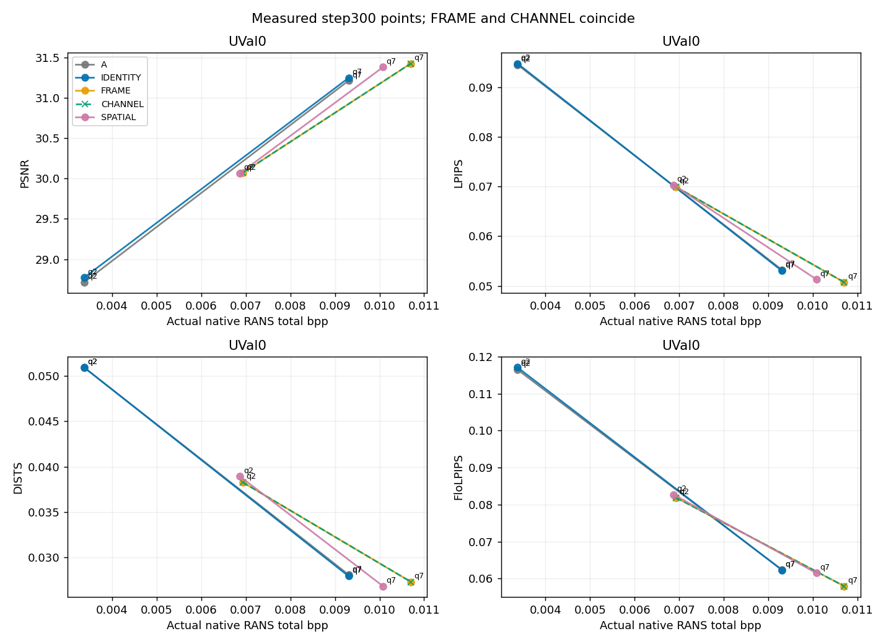
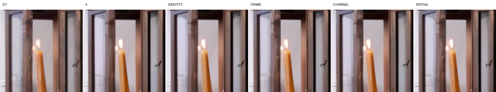
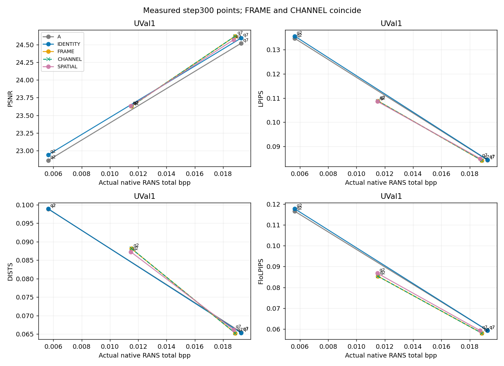
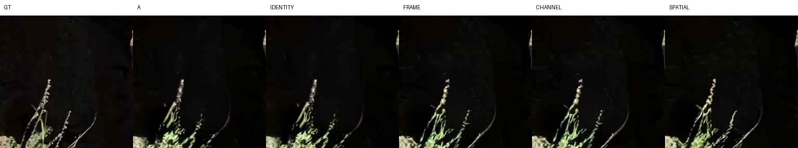
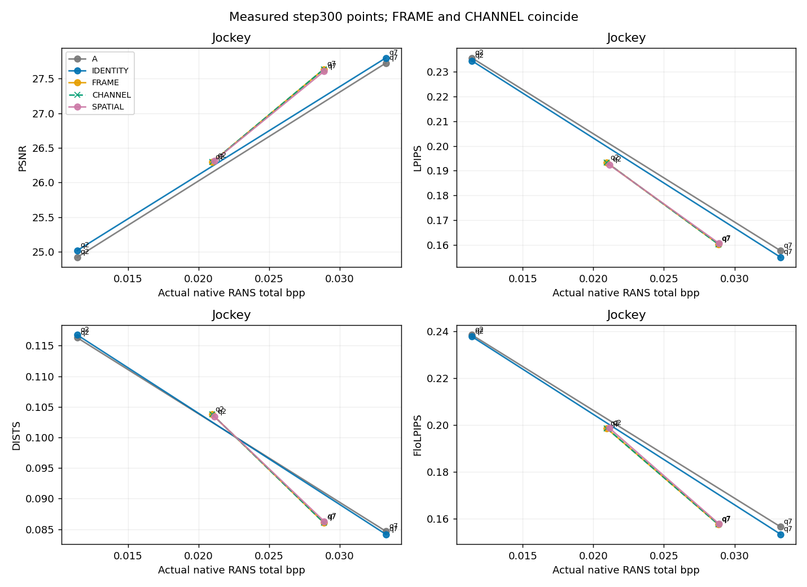
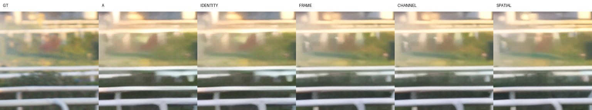
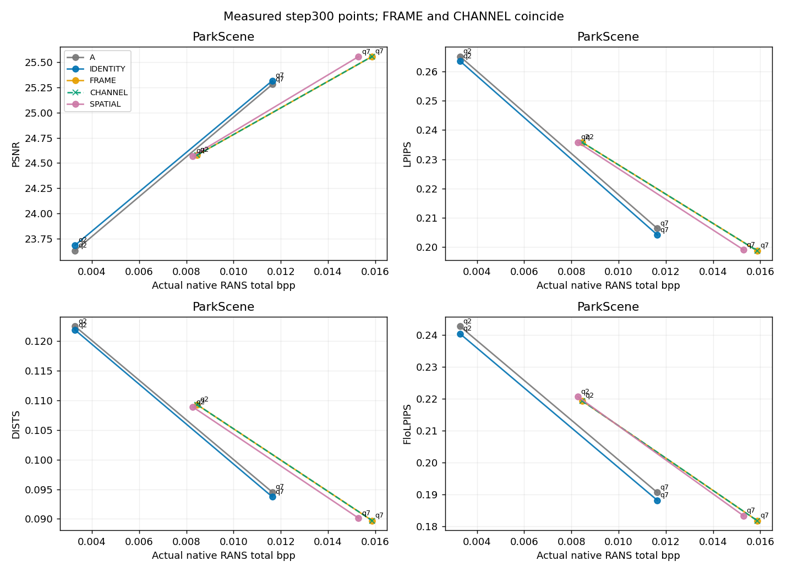
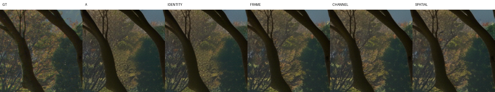
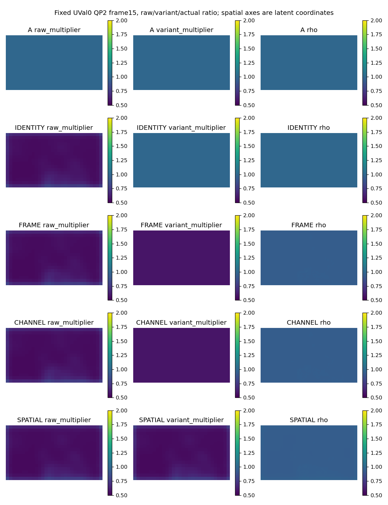

# v4 quantization granularity ablation

## Result and code facts

**Observed conclusion:** FRAME and CHANNEL are exactly equivalent on this singleton-channel H. SPATIAL has no stable across-sequence/metric/interpolation advantage over them in this run. Additional spatial changes are smaller in magnitude than FRAME-versus-IDENTITY changes in 30/32 cases; this describes scale sensitivity, not guaranteed gains: FRAME improves over IDENTITY in only 9/32 cases. IDENTITY explains at least half of positive SPATIAL-versus-A improvement in 4/10 applicable cases, and cannot be claimed to explain the main gain universally. Each case is one video/metric/interpolation combination, not an independent sample. These results do not establish spatial generation-aware bit allocation as the source of a robust gain.

This completed inference-only ablation uses 40 new native 64-frame streams, QP2/7, alpha1, step300, zero training updates. All encoder/independent-decoder hashes and original A/IDENTITY native-state/stream checks pass.

The existing H11 emits one multiplier channel shared across128 latent channels. FRAME and CHANNEL are therefore exactly the same operation, not independent spatial/channel interventions. Their eight pairs of measured streams, states and metrics are identical. This is a code and measured equality; it does not establish that a separately trained channel-dependent H would be ineffective.

A is the requested v1 A step300 generator with the original codec; IDENTITY keeps H11 G but sets m=1. They share compressed streams/states, while their RGB outputs can differ. No untouched official-generator baseline is added.

## Measured points and dominance

All table values below are measured native RANS points. Lower LPIPS/DISTS/FloLPIPS and higher PSNR are better. The complete table also records actual bytes, P payload, estimated y/z bits, time, memory and GPU. Actual y/z RANS payload is combined.

| mode | sequence | external_qp | actual_bpp | PSNR | LPIPS | DISTS | FloLPIPS |
| --- | --- | --- | --- | --- | --- | --- | --- |
| A | UVal0 | 2 | 0.003372878 | 28.71422 | 0.09456132 | 0.05091124 | 0.1164677 |
| A | UVal0 | 7 | 0.009306038 | 31.2132 | 0.05322004 | 0.0280963 | 0.06238379 |
| IDENTITY | UVal0 | 2 | 0.003372878 | 28.77176 | 0.09479953 | 0.05092307 | 0.1170566 |
| IDENTITY | UVal0 | 7 | 0.009306038 | 31.24732 | 0.05299863 | 0.02793202 | 0.06232216 |
| FRAME | UVal0 | 2 | 0.006929796 | 30.07067 | 0.06992944 | 0.03827982 | 0.08188042 |
| FRAME | UVal0 | 7 | 0.01070144 | 31.42563 | 0.0507083 | 0.02731454 | 0.05796289 |
| CHANNEL | UVal0 | 2 | 0.006929796 | 30.07067 | 0.06992944 | 0.03827982 | 0.08188042 |
| CHANNEL | UVal0 | 7 | 0.01070144 | 31.42563 | 0.0507083 | 0.02731454 | 0.05796289 |
| SPATIAL | UVal0 | 2 | 0.006870961 | 30.06566 | 0.07033777 | 0.03891406 | 0.08271807 |
| SPATIAL | UVal0 | 7 | 0.01007825 | 31.38075 | 0.05129926 | 0.0268343 | 0.06149042 |
| A | UVal1 | 2 | 0.005635067 | 22.86178 | 0.1347036 | 0.09886484 | 0.1165151 |
| A | UVal1 | 7 | 0.01926185 | 24.51806 | 0.08430324 | 0.06553047 | 0.05937767 |
| IDENTITY | UVal1 | 2 | 0.005635067 | 22.9418 | 0.135637 | 0.09891787 | 0.1176688 |
| IDENTITY | UVal1 | 7 | 0.01926185 | 24.59148 | 0.08441101 | 0.06533023 | 0.0593943 |
| FRAME | UVal1 | 2 | 0.01151048 | 23.62637 | 0.1088178 | 0.08816466 | 0.08537995 |
| FRAME | UVal1 | 7 | 0.01885616 | 24.62077 | 0.08417509 | 0.06524441 | 0.05810464 |
| CHANNEL | UVal1 | 2 | 0.01151048 | 23.62637 | 0.1088178 | 0.08816466 | 0.08537995 |
| CHANNEL | UVal1 | 7 | 0.01885616 | 24.62077 | 0.08417509 | 0.06524441 | 0.05810464 |
| SPATIAL | UVal1 | 2 | 0.0114734 | 23.6311 | 0.1086144 | 0.08726076 | 0.08682239 |
| SPATIAL | UVal1 | 7 | 0.01874017 | 24.56801 | 0.08493256 | 0.06616244 | 0.05932954 |
| A | Jockey | 2 | 0.01139648 | 24.91961 | 0.2356627 | 0.1162912 | 0.2384825 |
| A | Jockey | 7 | 0.03326359 | 27.72583 | 0.1575666 | 0.08467778 | 0.1566105 |
| IDENTITY | Jockey | 2 | 0.01139648 | 25.01712 | 0.2345008 | 0.1167442 | 0.2377578 |
| IDENTITY | Jockey | 7 | 0.03326359 | 27.8008 | 0.154919 | 0.08418405 | 0.153436 |
| FRAME | Jockey | 2 | 0.02096071 | 26.29309 | 0.1932392 | 0.1037705 | 0.1985804 |
| FRAME | Jockey | 7 | 0.02886206 | 27.63655 | 0.1602152 | 0.08608863 | 0.1575939 |
| CHANNEL | Jockey | 2 | 0.02096071 | 26.29309 | 0.1932392 | 0.1037705 | 0.1985804 |
| CHANNEL | Jockey | 7 | 0.02886206 | 27.63655 | 0.1602152 | 0.08608863 | 0.1575939 |
| SPATIAL | Jockey | 2 | 0.02112564 | 26.31662 | 0.1924133 | 0.1033767 | 0.1987731 |
| SPATIAL | Jockey | 7 | 0.02889673 | 27.60886 | 0.1605707 | 0.08629675 | 0.157895 |
| A | ParkScene | 2 | 0.003284264 | 23.62951 | 0.2651364 | 0.1225031 | 0.2426161 |
| A | ParkScene | 7 | 0.01164014 | 25.28072 | 0.2063802 | 0.09451137 | 0.1905833 |
| IDENTITY | ParkScene | 2 | 0.003284264 | 23.68395 | 0.2635675 | 0.1218885 | 0.2403081 |
| IDENTITY | ParkScene | 7 | 0.01164014 | 25.31762 | 0.2041768 | 0.09371716 | 0.1881388 |
| FRAME | ParkScene | 2 | 0.00845673 | 24.57983 | 0.2357827 | 0.1092708 | 0.2192834 |
| FRAME | ParkScene | 7 | 0.01586908 | 25.55868 | 0.1987553 | 0.08970577 | 0.1817722 |
| CHANNEL | ParkScene | 2 | 0.00845673 | 24.57983 | 0.2357827 | 0.1092708 | 0.2192834 |
| CHANNEL | ParkScene | 7 | 0.01586908 | 25.55868 | 0.1987553 | 0.08970577 | 0.1817722 |
| SPATIAL | ParkScene | 2 | 0.008274498 | 24.57047 | 0.2358117 | 0.1088856 | 0.2205879 |
| SPATIAL | ParkScene | 7 | 0.01529128 | 25.55685 | 0.1990719 | 0.09012952 | 0.1832948 |

[observed_dominance.csv](observed_dominance.csv) records every cross-QP pair in both directions, including unfavorable differences. Observed dominance is rate no higher and quality no worse, with at least one strict improvement; interpolated rankings below are distinct from this measured-point claim.

| comparison | measured_pairs | method_joint_dominance | reference_joint_dominance |
| --- | --- | --- | --- |
| SPATIAL-FRAME | 16 | 0 | 1 |
| SPATIAL-CHANNEL | 16 | 0 | 1 |
| SPATIAL-IDENTITY | 16 | 0 | 0 |
| IDENTITY-A | 16 | 4 | 0 |

## Who is best at similar actual rates?

The following rankings are interpolated quality at the midpoint of the common FRAME/CHANNEL/SPATIAL observed rate overlap for each sequence. Both interpolation definitions use the same actual-bpp query coordinate. They are descriptive, not new measured encodings or BD-rate.

| sequence | interpolation | metric | actual_bpp | winners | FRAME | CHANNEL | SPATIAL |
| --- | --- | --- | --- | --- | --- | --- | --- |
| UVal0 | linear-bpp | LPIPS | 0.008504021 | ['SPATIAL'] | 0.06190683 | 0.06190683 | 0.06064389 |
| UVal0 | linear-bpp | DISTS | 0.008504021 | ['SPATIAL'] | 0.03370308 | 0.03370308 | 0.03276338 |
| UVal0 | linear-bpp | FloLPIPS | 0.008504021 | ['FRAME', 'CHANNEL'] | 0.07189761 | 0.07189761 | 0.07190954 |
| UVal0 | linear-bpp | PSNR | 0.008504021 | ['SPATIAL'] | 30.63621 | 30.63621 | 30.73526 |
| UVal0 | log-bpp | LPIPS | 0.008504021 | ['SPATIAL'] | 0.06087466 | 0.06087466 | 0.05974017 |
| UVal0 | log-bpp | DISTS | 0.008504021 | ['SPATIAL'] | 0.03311424 | 0.03311424 | 0.03218998 |
| UVal0 | log-bpp | FloLPIPS | 0.008504021 | ['FRAME', 'CHANNEL'] | 0.07061324 | 0.07061324 | 0.0709019 |
| UVal0 | log-bpp | PSNR | 0.008504021 | ['SPATIAL'] | 30.70897 | 30.70897 | 30.79769 |
| UVal1 | linear-bpp | LPIPS | 0.01512533 | ['FRAME', 'CHANNEL'] | 0.09669098 | 0.09669098 | 0.09671308 |
| UVal1 | linear-bpp | DISTS | 0.01512533 | ['SPATIAL'] | 0.07688548 | 0.07688548 | 0.07665778 |
| UVal1 | linear-bpp | FloLPIPS | 0.01512533 | ['FRAME', 'CHANNEL'] | 0.07195762 | 0.07195762 | 0.07300584 |
| UVal1 | linear-bpp | PSNR | 0.01512533 | ['FRAME', 'CHANNEL'] | 24.11572 | 24.11572 | 24.10195 |
| UVal1 | log-bpp | LPIPS | 0.01512533 | ['FRAME', 'CHANNEL'] | 0.09518227 | 0.09518227 | 0.09527624 |
| UVal1 | log-bpp | DISTS | 0.01512533 | ['SPATIAL'] | 0.07548223 | 0.07548223 | 0.07537769 |
| UVal1 | log-bpp | FloLPIPS | 0.01512533 | ['FRAME', 'CHANNEL'] | 0.07028774 | 0.07028774 | 0.07133777 |
| UVal1 | log-bpp | PSNR | 0.01512533 | ['FRAME', 'CHANNEL'] | 24.1766 | 24.1766 | 24.15879 |
| Jockey | linear-bpp | LPIPS | 0.02499385 | ['FRAME', 'CHANNEL'] | 0.1763825 | 0.1763825 | 0.176563 |
| Jockey | linear-bpp | DISTS | 0.02499385 | ['FRAME', 'CHANNEL'] | 0.09474504 | 0.09474504 | 0.09487481 |
| Jockey | linear-bpp | FloLPIPS | 0.02499385 | ['FRAME', 'CHANNEL'] | 0.1776593 | 0.1776593 | 0.1784252 |
| Jockey | linear-bpp | PSNR | 0.02499385 | ['FRAME', 'CHANNEL'] | 26.97884 | 26.97884 | 26.95986 |
| Jockey | log-bpp | LPIPS | 0.02499385 | ['FRAME', 'CHANNEL'] | 0.1750711 | 0.1750711 | 0.1753207 |
| Jockey | log-bpp | DISTS | 0.02499385 | ['FRAME', 'CHANNEL'] | 0.09404289 | 0.09404289 | 0.09420847 |
| Jockey | log-bpp | FloLPIPS | 0.02499385 | ['FRAME', 'CHANNEL'] | 0.1760318 | 0.1760318 | 0.1768304 |
| Jockey | log-bpp | PSNR | 0.02499385 | ['FRAME', 'CHANNEL'] | 27.03219 | 27.03219 | 27.01027 |
| ParkScene | linear-bpp | LPIPS | 0.01187401 | ['SPATIAL'] | 0.2187122 | 0.2187122 | 0.2169648 |
| ParkScene | linear-bpp | DISTS | 0.01187401 | ['SPATIAL'] | 0.1002509 | 0.1002509 | 0.09926399 |
| ParkScene | linear-bpp | FloLPIPS | 0.01187401 | ['SPATIAL'] | 0.2019898 | 0.2019898 | 0.2014571 |
| ParkScene | linear-bpp | PSNR | 0.01187401 | ['SPATIAL'] | 25.0311 | 25.0311 | 25.07647 |
| ParkScene | log-bpp | LPIPS | 0.01187401 | ['SPATIAL'] | 0.2158169 | 0.2158169 | 0.214204 |
| ParkScene | log-bpp | DISTS | 0.01187401 | ['SPATIAL'] | 0.09872101 | 0.09872101 | 0.09785457 |
| ParkScene | log-bpp | FloLPIPS | 0.01187401 | ['SPATIAL'] | 0.1990567 | 0.1990567 | 0.1986547 |
| ParkScene | log-bpp | PSNR | 0.01187401 | ['SPATIAL'] | 25.10764 | 25.10764 | 25.15059 |

## Is SPATIAL stably better than FRAME and CHANNEL?

| metric | checked_sequence_method_interpolation_coordinates | favorable | unfavorable | ties | strictly_favorable_everywhere |
| --- | --- | --- | --- | --- | --- |
| LPIPS | 48 | 30 | 18 | 0 | False |
| DISTS | 48 | 30 | 18 | 0 | False |
| FloLPIPS | 48 | 12 | 36 | 0 | False |
| PSNR | 48 | 28 | 20 | 0 | False |

SPATIAL is not consistently better across all tested metrics, sequences and interpolation coordinates. These fixed-checkpoint results do not support a stable, general spatial-allocation advantage.

| metric | sequence_interpolation_cases | SPATIAL_best | FRAME_CHANNEL_best |
| --- | --- | --- | --- |
| LPIPS | 8 | 4 | 4 |
| DISTS | 8 | 6 | 2 |
| FloLPIPS | 8 | 2 | 6 |
| PSNR | 8 | 4 | 4 |

### Global-scale versus additional spatial change

Both comparisons below share one actual rate coordinate inside the IDENTITY/FRAME/SPATIAL overlap, with favorable changes positive. They quantify descriptive magnitudes, not a learned-mechanism decomposition.

| sequence | interpolation | metric | FRAME_over_IDENTITY_improvement | SPATIAL_over_FRAME_improvement | absolute_space_to_frame_effect_ratio |
| --- | --- | --- | --- | --- | --- |
| UVal0 | linear-bpp | LPIPS | -0.002505201 | 0.0009386928 | 0.3746976 |
| UVal0 | linear-bpp | DISTS | -0.002289597 | 0.0006080132 | 0.2655546 |
| UVal0 | linear-bpp | FloLPIPS | -0.001063268 | -0.0001189425 | 0.1118651 |
| UVal0 | linear-bpp | PSNR | -0.2540881 | 0.07944837 | 0.3126805 |
| UVal0 | log-bpp | LPIPS | -0.004305538 | 0.0008804793 | 0.2044993 |
| UVal0 | log-bpp | DISTS | -0.003260474 | 0.0006315394 | 0.1936956 |
| UVal0 | log-bpp | FloLPIPS | -0.003482111 | -0.0003060285 | 0.0878859 |
| UVal0 | log-bpp | PSNR | -0.3500626 | 0.0740874 | 0.2116405 |
| UVal1 | linear-bpp | LPIPS | 0.003270109 | -2.210599e-05 | 0.006760016 |
| UVal1 | linear-bpp | DISTS | -0.001359432 | 0.0002276953 | 0.1674929 |
| UVal1 | linear-bpp | FloLPIPS | 0.005126384 | -0.001048215 | 0.2044745 |
| UVal1 | linear-bpp | PSNR | 0.02501433 | -0.01377305 | 0.5506063 |
| UVal1 | log-bpp | LPIPS | -0.000695594 | -9.396321e-05 | 0.1350834 |
| UVal1 | log-bpp | DISTS | -0.00354562 | 0.000104541 | 0.02948456 |
| UVal1 | log-bpp | FloLPIPS | 0.0005686018 | -0.001050025 | 1.846679 |
| UVal1 | log-bpp | PSNR | -0.09040352 | -0.01780792 | 0.1969826 |
| Jockey | linear-bpp | LPIPS | 0.008632808 | -0.0001804568 | 0.0209036 |
| Jockey | linear-bpp | DISTS | 0.00175264 | -0.0001297686 | 0.0740418 |
| Jockey | linear-bpp | FloLPIPS | 0.007665567 | -0.0007658544 | 0.09990838 |
| Jockey | linear-bpp | PSNR | 0.2307725 | -0.01898324 | 0.08225954 |
| Jockey | log-bpp | LPIPS | 0.001083851 | -0.0002495658 | 0.2302584 |
| Jockey | log-bpp | DISTS | -0.001170331 | -0.0001655775 | 0.1414792 |
| Jockey | log-bpp | FloLPIPS | -9.493365e-05 | -0.0007986481 | 8.412698 |
| Jockey | log-bpp | PSNR | -0.02580314 | -0.0219177 | 0.8494199 |
| ParkScene | linear-bpp | LPIPS | -0.01234142 | 0.001308125 | 0.1059947 |
| ParkScene | linear-bpp | DISTS | -0.005985992 | 0.000925718 | 0.1546474 |
| ParkScene | linear-bpp | FloLPIPS | -0.01315187 | 6.864963e-05 | 0.005219762 |
| ParkScene | linear-bpp | PSNR | -0.2164051 | 0.02982118 | 0.1378026 |
| ParkScene | log-bpp | LPIPS | -0.01455879 | 0.001446332 | 0.09934423 |
| ParkScene | log-bpp | DISTS | -0.006919177 | 0.0009570316 | 0.1383158 |
| ParkScene | log-bpp | FloLPIPS | -0.01480418 | 0.0002133125 | 0.01440894 |
| ParkScene | log-bpp | PSNR | -0.2797495 | 0.03443495 | 0.1230921 |

The absolute additional SPATIAL-over-FRAME change is smaller than the FRAME-over-IDENTITY change in 30/32 sequence/metric/interpolation cases. Where FRAME already matches or beats SPATIAL, there is no measured-interpolation need for spatial positioning to explain that quality/rate performance. This supports a scale-based explanation only for those observed cases; it is not an equivalence test or proof of absence of spatial effects.

FRAME and CHANNEL equality is required by the architecture. Whether they approximate SPATIAL must be read from the numerical differences; no arbitrary equivalence threshold is introduced. A failure to see stable SPATIAL superiority is not proof that spatial allocation has no causal effect.

## Does IDENTITY explain the main gain?

Positive improvement is defined in the favorable direction. On the common A/IDENTITY/SPATIAL observed overlap, the identity fraction is (IDENTITY−A improvement)/(SPATIAL−A improvement). It is reported only for a positive total above1e-8, can exceed1 or be negative, and is not a causal decomposition.

| sequence | interpolation | metric | SPATIAL_total_improvement | IDENTITY_improvement | SPATIAL_increment_over_IDENTITY | identity_fraction_of_positive_total | majority_explained |
| --- | --- | --- | --- | --- | --- | --- | --- |
| UVal0 | linear-bpp | LPIPS | -0.001406791 | 0.0001270852 | -0.001533876 |  | not_applicable_nonpositive_total |
| UVal0 | linear-bpp | DISTS | -0.001550251 | 0.0001281364 | -0.001678388 |  | not_applicable_nonpositive_total |
| UVal0 | linear-bpp | FloLPIPS | -0.001177402 | -7.187209e-05 | -0.00110553 |  | not_applicable_nonpositive_total |
| UVal0 | linear-bpp | PSNR | -0.1354963 | 0.03893128 | -0.1744276 |  | not_applicable_nonpositive_total |
| UVal0 | log-bpp | LPIPS | -0.003298058 | 0.0001579009 | -0.003455959 |  | not_applicable_nonpositive_total |
| UVal0 | log-bpp | DISTS | -0.002521229 | 0.0001399438 | -0.002661173 |  | not_applicable_nonpositive_total |
| UVal0 | log-bpp | FloLPIPS | -0.003821777 | -2.825437e-05 | -0.003793522 |  | not_applicable_nonpositive_total |
| UVal0 | log-bpp | PSNR | -0.2422215 | 0.03736131 | -0.2795828 |  | not_applicable_nonpositive_total |
| UVal1 | linear-bpp | LPIPS | 0.002897774 | -0.000359503 | 0.003257277 | -0.1240618 | False |
| UVal1 | linear-bpp | DISTS | -0.001016857 | 0.0001230091 | -0.001139866 |  | not_applicable_nonpositive_total |
| UVal1 | linear-bpp | FloLPIPS | 0.003723971 | -0.0003633394 | 0.00408731 | -0.09756773 | False |
| UVal1 | linear-bpp | PSNR | 0.08652501 | 0.0754296 | 0.01109541 | 0.8717665 | True |
| UVal1 | log-bpp | LPIPS | -0.001068615 | -0.0002709763 | -0.000797639 |  | not_applicable_nonpositive_total |
| UVal1 | log-bpp | DISTS | -0.003310134 | 0.0001501665 | -0.003460301 |  | not_applicable_nonpositive_total |
| UVal1 | log-bpp | FloLPIPS | -0.0007334118 | -0.0002414139 | -0.0004919979 |  | not_applicable_nonpositive_total |
| UVal1 | log-bpp | PSNR | -0.03418473 | 0.07472252 | -0.1089073 |  | not_applicable_nonpositive_total |
| Jockey | linear-bpp | LPIPS | 0.01054729 | 0.002086994 | 0.008460293 | 0.1978702 | False |
| Jockey | linear-bpp | DISTS | 0.001771619 | 0.0001364619 | 0.001635157 | 0.07702668 | False |
| Jockey | linear-bpp | FloLPIPS | 0.009174093 | 0.002250045 | 0.006924048 | 0.2452607 | False |
| Jockey | linear-bpp | PSNR | 0.2959429 | 0.08347793 | 0.212465 | 0.2820744 | False |
| Jockey | log-bpp | LPIPS | 0.003105443 | 0.002252193 | 0.0008532505 | 0.7252404 | True |
| Jockey | log-bpp | DISTS | -0.001077457 | 0.0002417256 | -0.001319183 |  | not_applicable_nonpositive_total |
| Jockey | log-bpp | FloLPIPS | 0.00166475 | 0.002522439 | -0.0008576892 | 1.515206 | True |
| Jockey | log-bpp | PSNR | 0.03430948 | 0.08097211 | -0.04666262 | 2.36005 | True |
| ParkScene | linear-bpp | LPIPS | -0.008787197 | 0.002075558 | -0.01086275 |  | not_applicable_nonpositive_total |
| ParkScene | linear-bpp | DISTS | -0.004238597 | 0.0007580402 | -0.004996638 |  | not_applicable_nonpositive_total |
| ParkScene | linear-bpp | FloLPIPS | -0.01058157 | 0.002417037 | -0.01299861 |  | not_applicable_nonpositive_total |
| ParkScene | linear-bpp | PSNR | -0.1411461 | 0.04043204 | -0.1815782 |  | not_applicable_nonpositive_total |
| ParkScene | log-bpp | LPIPS | -0.01110484 | 0.002125031 | -0.01322987 |  | not_applicable_nonpositive_total |
| ParkScene | log-bpp | DISTS | -0.005265503 | 0.0007720455 | -0.006037549 |  | not_applicable_nonpositive_total |
| ParkScene | log-bpp | FloLPIPS | -0.01234078 | 0.002427682 | -0.01476847 |  | not_applicable_nonpositive_total |
| ParkScene | log-bpp | PSNR | -0.2091205 | 0.03906414 | -0.2481846 |  | not_applicable_nonpositive_total |

IDENTITY accounts for at least half of the interpolated positive total improvement in 4/10 applicable sequence/metric/interpolation cases. Nonpositive-total cases are not evidence of explained positive gain. Inspect metric-specific rows; there is no single validated all-metric attribution percentage.

## Audits and scope

[delivery_audit.json](delivery_audit.json) verifies40 full64-frame streams,2520 full P-frame map files, every durable artifact SHA, native I equality, A/IDENTITY native byte/state parity, decoder state and multiplier-map equality, the post-clamp/post-dtype q/rho equations, and metrics recomputed from saved per-frame tables. [cross_mode_audit.json](cross_mode_audit.json) verifies FRAME/CHANNEL equality independently at all8 video/QP pairs. [P rate accounting](estimated_vs_actual_P_rate.csv) excludes I and headers; analytic y/z estimates remain separate from the real combined RANS P payload. FID:not_computed. No training, alpha search, extra QP or legacy result modification occurred.

The shared mode is fixed experiment configuration; the native file has no new header or encoder-only map. Raw and variant multipliers are B×1×H×W; actual qmap/rho/effective multiplier contain128 channels. Effective means the realized native-dtype ratio q_new/q_base, not an unclamped proposal.

## Unverified causal claims and limitations

Two-QP interpolation, one trained checkpoint/seed, inherited historical training exposure and four videos cannot establish significance, convergence, or generalization. FRAME/CHANNEL equality prevents independently attributing benefits to channelwise H. SPATIAL-vs-FRAME changes the whole causal reference trajectory as well as local scales; it does not isolate a position-only bit-budget redistribution at fixed total bits. IDENTITY-vs-A changes G as specified; interpolated gain fractions are descriptive and can be unstable near zero. Stable SPATIAL superiority would support the spatial-allocation hypothesis within this protocol, but would still not identify a unique mechanism.

These are inference-time interventions on a spatially trained H. FRAME/CHANNEL are not separately trained optimums. Actual native q_base can vary over channels even when the multiplier is one channel. Model timing includes map saving/diagnostics, and peak memory includes metrics/native-parity work, so it is not a controlled speed benchmark.

## Curves and fixed previews

[Protocol](PROTOCOL.md) · [Interpolation table](matched-rate_comparisons.csv) · [Map/stream/weight paths and SHA256](artifact_index.json)
